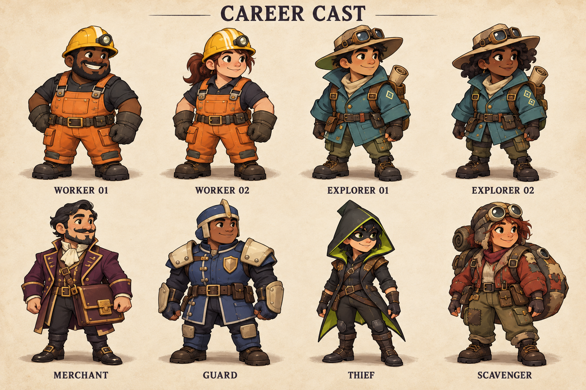

**Character appearance design — asset reference updated October 30, 2026.** This accompanies [game design v0.4](game-design-v04.md), including its club, blade, and gun tiers, private wallets, silent theft, lanterns, and healing. The filename retains the original art version; these instructions are current. The [new static 2D asset pack](asset-pack-v01.md) contains eight transparent career appearances and matching items/rooms. No game implementation or directional animation set was created.

The original concept sheet and exact prompt below remain historical provenance. New single-view sprite generation is recorded separately in [character-prompts.json](../game-assets-v01/character-prompts.json), with [visual origins and alpha bounds](../game-assets-v01/character-metadata.json). The detailed production-animation and privacy guidance still applies.

October 30 accepted update: use shared body, identity/head, and career-outfit components with stable attachment points. The static PNGs bake face and outfit together, so they remain references and prototype sprites; they do not yet satisfy arbitrary face/hair preservation through career conversion. The [next asset brief](next-asset-batch-v02.md) specifies a shared identity pilot before full animation and the eight required mild haunt appearances. These are production requirements; no new images or animations have been delivered in this update.

October 29 consolidated handoff: [master game design and implementation plan](../master-game-design.md). It incorporates career appearance and asset/privacy requirements alongside the complete rules and structured source layout. Existing art and the original prompt are unchanged.

October29 reference update: [current design](design-update-2026-10-29.md). Small openings become clearly identifiable only on room discovery; no advance visual clues. Compass remains a single-use Survey prop, and saved pickaxes do not appear as free inventory tells. Original artwork/prompt is unchanged.

Latest item addition: [Explorer compass sold by Merchant](compass-and-natural-exit.md). Add a compass prop/icon for the Survey action; no passive equipment display, career costume change, free environmental exit clue or Smuggler tell.

Updated references October 28, 2026: [current rules and selected defaults](defaults-calculation-v05.md). Appearance/cover privacy remain unchanged. Forfeited disconnects grant no controlled ghost; ordinary eliminated players still do. Original artwork/prompt below remain preserved.

**The cast should look like an expedition crew with different jobs.** Use chunky, expressive 2D characters, roughly three heads tall, with clear outlines, restrained cel shading, worn work clothes, and a slightly elevated view. The mood is adventurous and mischievous, with tension coming from player choices. The illustrated sheet sets costume and palette direction; later game sprites must simplify its small details and match the map camera.

**Each career has a recognizable shape, costume, and badge.** Colors reinforce identity; they are never the only way to recognize a role. Palette values below are production targets rather than sampled measurements of the concept image.

| Career | Defining appearance | Silhouette and career icon | Palette targets |
|---|---|---|---|
| Worker | Yellow hardhat with an unlit round lamp; orange overalls; large gloves; broad work boots. Sturdy and practical. | Compact, square body with a domed helmet. Pickaxe career icon. | Amber `#F0BA3C`, orange `#D97830`, charcoal `#343743`. |
| Explorer | Broad tan field hat with folded goggles, teal expedition coat, compact upright backpack with rolled map, hiking boots. Alert and curious. | Wide hat above a narrow upright pack. Folded-map career icon; no usable compass implied. | Teal `#2C7C82`, sand `#D3BA83`, dark brown `#514235`. |
| Merchant | Plum waistcoat and short flared coat, cream collar, gold trim, rectangular ledger satchel with a square clasp. Composed and persuasive. | Upright coat with a flat rectangular bag at the hip. Balance-scale career icon. | Plum `#713A61`, cream `#EFE1BF`, brass `#D0A24F`. |
| Guard | Cobalt padded uniform, ivory shoulder and forearm plates, squared open-face helmet, decorative chest badge. Reliable and imposing. | Broad shoulders, squared helmet, stable stance. Watchtower career icon. | Cobalt `#38578A`, ivory `#D9D4BD`, steel `#747F8B`. |
| Thief | Charcoal fitted outfit, sharply pointed hood with lime lining, short split coat tails, dark eye mask, soft boots. Nimble and playful. | Narrow body under a distinct triangular hood. Hook career icon. | Charcoal `#343743`, lime `#B6CC56`, muted brown `#74604A`. |
| Scavenger | Patched rust-red utility jacket, olive cargo trousers, rounded aviator cap with goggles, large rounded salvage pack, reinforced boots. Inventive and resourceful. | Asymmetric round backpack and rounded cap. Open-chest career icon. | Rust `#A5533D`, olive `#758050`, canvas `#C6AE79`. |

The Guard's costume badge is decoration, not an active shield. The Worker's helmet lamp and the Explorer's equipment do not grant extra vision. Backpack size does not change storage, wallet capacity, or loot quantity. The Merchant's brass decorations do not indicate actual wealth. Every public career can be played by any supported face, skin tone, or gender presentation; the cast sheet shows example people, not demographic restrictions.

**The eight-player sheet includes both permitted duplicates.** Worker 01 and Worker 02 share the same role outfit; one/two helmet stripes and different faces distinguish the pictured examples. Explorer 01 and Explorer 02 share the same hat/coat/pack combination; one/two diamond patches and different faces distinguish them. The other four careers each appear once, consistent with their roster limits.

The sheet's 01/02 labels identify costume variants, not global player IDs. In a real match, all players receive a unique fixed ID from P1 to P8. Show that number with a small personal accent and geometric marker on the nameplate, roster, proposals, and results. Repeat a small version on the outfit where practical. A short nickname remains available on selection. Duplicate careers must remain distinguishable in grayscale and at phone size; tiny face details alone are insufficient.

Players may choose their face/hair preset before the match; the assigned career supplies the outfit. Personal markers and appearance lock when the match begins, preventing costume changes from becoming another communication channel. Public career colors remain stable rather than being replaced by personal colors. Character variants never change speed, interaction reach, targeting, or collision size.

**The production character is assembled from compatible components.** Keep the stable personal identity (face, hair, skin preset and P1–P8 marker), a common body/animation rig, the current public-career outfit, and action props separate. Every component uses the same facing direction, frame timing, feet origin and attachment coordinates. Hats must accommodate the supported hair presets without replacing the person's face. Shared components may be exported into compatible precomposed frame sets, but the export must preserve every supported identity/outfit combination. Prove one identity in Worker and Explorer outfits across all eight directions before extending the cast. Changing career replaces the outfit and badge, not the head or player identity.

**Explorer succession must remain visible and identity-safe.** The confirmed permanent conversion changes the elected player's outfit and career badge to Explorer in camp before normal choices, while keeping their fixed player number, personal marker, face, and secret identity private. It must not use a Smuggler-specific transition or reveal the former wallet. The previous career is replaced; the elected player must not display a dual-career badge or retain old-career abilities. The original concept sheet has not been replaced; new static career sprites are in the October 30 pack.

**Smugglers use exactly their public career's appearance.** A Worker-covered Smuggler wears the same Worker costume, uses the same animations, and has the same cosmetic options as an ordinary Worker. There are no special eyes, suspicious pockets, alternative portrait frames, or secret idle gestures. Secret assignment is independent of the cosmetic preset.

The owner's private identity card may show a small concealed-compartment emblem and “Smuggler — private escape: 25 coins.” It is a separate private UI panel, never an overhead badge or world texture sent to other players. At the end, the result card can reveal the secret emblem alongside the original public career portrait. No separate public Smuggler costume is needed.

**Equipment appears when an action makes it visible.** Default sprites have empty hands. Pickaxes, drills, crowbars, Deposit slips, clubs, blades, the single-shot gun, potions, rescue kits, lanterns, and the paid Survey compass appear during their corresponding permitted action animations, only to the actor and permitted local witnesses. Theft has no visible Hook animation, sound, victim effect, or identifying observer event, including at choice-close settlement. A Hook icon exists only in its owner’s private loadout and targeting interface. No career holds a permanent weapon. Idle sprites do not disclose purchased weapons, remaining tools, or the player's prepared loadout. Health pips appear only in the owner's UI and permitted local views, not on distant global roster cards.

Use one consistent prop design for each tool across all careers. When a physical tool's accepted use completes or is interrupted, a brief break/discard effect signals consumption. An invalid action that never starts has no break effect. Deposit uses a short slip-and-coin animation after the transfer succeeds; gunfire consumes the gun even when a life shield blocks it. Effects may not delay the authoritative result or extend the action deadline. The owner’s private wallet, inventory, expiry labels, and action slots remain the source of truth; no overhead coin counter or wealth-dependent costume is permitted.

**Temporary protection has its own visual language.** Wallet protection uses a padlock icon. Life protection uses a shield icon with a one-charge indicator. A client may have both. These status symbols are distinct from the Guard's static costume and career badge; Guard appearance grants no protection by itself.

The owner's UI shows current protection. Global player cards may show that a public contract was purchased this round, but must not silently become a real-time feed of unseen attacks: an off-screen shield breaking is not globally announced. Nearby witnesses see a brief shield fracture when a hit is blocked. Wallet protection disappears on death; the body remains lootable. Guard status effects expire at the next arrival boundary. Item instances use their own round expiry; placing a lantern does not restart its lifetime.

**Ghosts remain recognizable as the person who died.** Preserve the hat/hood, backpack outline, personal marker, and face, rendered in pale blue-gray with a soft translucent edge. Replace walking feet with a small floating mist tail. Avoid flashing, long trails, or an opaque glow that obscures the map. Ghosts do not carry usable tools.

Ghosts can see every player avatar across the discovered map, including other ghosts, regardless of darkness, distance or walls. This observer permission does not reveal undiscovered rooms, future openings, private wallets, inventories, private compass readings, remote HP/action details, or secret careers, and it does not transmit that view to living players. Living bystanders cannot see a ghost following someone. Escaped spectators use their separately specified observer permissions; ghost visibility is not a blanket spectator permission.

**Each ghost can haunt only their own murderer once per base round, at any time during an active match.** The effect is allowed during camp, choices and meetings as well as field play; it does not spend an action. Follow the authoritative gameplay contract for target eligibility, receipt handling and round reset. The approved presentation is a **450 ms** soft character pop at a clear screen edge, using the deceased player's face, personal marker and public outfit at death. It makes a small upward hop and settles/fades; no full-screen face, scream, gore, flashing, camera shake, control capture, timer pause, aiming penalty or obscured buttons. Use an optional quiet rounded pop sound; audio is never required to perceive the effect. Reduced-motion mode shows a small stationary portrait for the same duration. The scare is cosmetic and should feel like a playful surprise.

Roaming ghost forms are visible only to ghosts. Only the haunting ghost and their murderer receive the separate haunt presentation; no living bystander gets an event, pointer, trail or sound that identifies the murderer. Simultaneous different ghosts combine in one 450 ms appearance strip rather than stacking motion or audio. A ghost or corpse never reveals a hidden Smuggler identity before the final reveal. Every launch appearance needs a matching haunt: Worker 01, Worker 02, Explorer 01, Explorer 02, Merchant, Guard, Thief and Scavenger. These eight presentation sets share one timing rig and must also preserve the supported face/hair/skin preset after an Explorer conversion. They are specified, not yet generated. See the [per-character haunt brief and missing asset list](next-asset-batch-v02.md) and [authoritative delivery/reset contract](design-update-2026-10-30.md).

Corpses use a compact, non-graphic fallen version of the public outfit. Retain the personal marker so local players can identify the body. A loot marker disappears when its coins are exhausted; no additional coin amount is inferred from bag size. Neither corpse art nor ghost art changes fund accounting or target eligibility.

**Personality comes from automatic animation, not extra communication controls.** Workers shift their heavy gloves; Explorers glance around; Merchants adjust their lapels; Guards stand steady; Thieves lean lightly on their toes; Scavengers settle their packs. These idle motions are cosmetic and must not imply available actions, secret identity, or an imminent decision. Do not add manual emotes or custom gesture messages. Reduced-motion mode replaces flourishes with small static state indicators.

**Light, health, and stored equipment follow the current rules.** The Merchant's personal potion grant does not add visible bottles to their costume or reveal stored quantity. Healing uses a small local potion effect only when the server authorizes it; it costs an action and never raises health above three. Trial execution has a neutral, non-graphic effect distinct from a gunshot. A Trial action marker is UI, not an automatically visible weapon.

Lanterns are placed world props with a clear lifetime label for permitted viewers. Safe Zones use permanent shining minerals and distinct geometry; temporary lantern light must not make an ordinary room appear legally safe. The vision cone and wall-clipped shadows must remain readable on phones without darkening critical controls. A character's unlit costume lamp never replaces a purchased lantern.

Use separate art states for active mine, exhausted mine, unopened boundary, trap, cache, and ordinary gallery. Ghost visibility never illuminates undiscovered content or changes a living player's vision. Color alone cannot identify safe ground or a target; use shapes, texture, icons, and labels. Personal inventory has seven fixed physical-item slots; outfit pockets and backpacks never add capacity. The UI distinguishes these seven item slots from the two free action slots and up to two purchased action slots. Shopping and atomic action/tool checkout have no action-use animation; using a prepared tool and making a Deposit do.

**The art handoff remains separate from implementation.** The original sheet is an illustrated concept, and the delivered eight transparent character PNGs are single-view idle sprites. Neither is a directional animation atlas or a tested top-down asset. A later art pass must produce aligned eight-direction idle/walk components, shared action-prop overlays, death/ghost states, all eight mild haunt appearances, portraits, and badges. Keep the same foot anchor and gameplay footprint across all careers and variants. Simplify fabric seams, straps, and face details before shrinking to the intended on-map display size.

Before accepting production sprites, check that each career reads by silhouette at phone size; duplicate careers remain identifiable without color; back-facing characters retain their career cues; clothing and packs do not hide target selection; public covers and elected Explorer transitions have identical ordinary/Smuggler rendering; all eight haunts retain the correct deceased identity without obscuring play; and no animation reveals information the server should keep private. Check the mild haunt with motion and sound reduced, during a ballot, and at small phone size. These are future visual checks, not completed playtests.

**Deliverables.** [Concept sheet](../concept-art/career-cast-v01.png), [exact image prompt and generation record](career-art-prompt-v01.md), and [full game design](game-design-v04.md). The built-in imagegen tool produced the selected sheet; the prompt record preserves the production brief.
