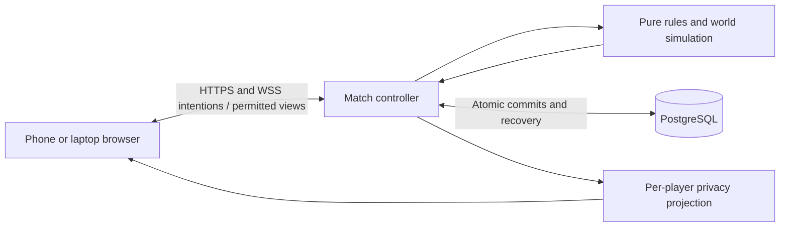

# Mine Escape — master game design and implementation plan

Updated **October 30, 2026** with adopted interaction, inventory, ghost and server contracts. Working title: **Mine Escape**. Rules version: `mine-escape-playtest-2026-10-30-interactions`.

**Art now available:** [38-PNG asset pack and gallery](docs/asset-pack-v01.md), covering eight career appearances, eighteen item/service icons and twelve room plates/states. [Import metadata](game-assets-v01/manifest.json) and [proposed room geometry](game-assets-v01/rooms-layouts.json) accompany the source art. These are static prototype assets; animation, collision/occlusion and application integration have not been completed.

**Latest decisions:** the [October 30 decision record](docs/design-update-2026-10-30.md) resolves the action/loot/checkout/observer, identity and server contracts identified in the [review](docs/preimplementation-review-2026-10-30.md). The [next asset brief](docs/next-asset-batch-v02.md) includes eight mild character haunts and a modular identity/room kit. These rules are adopted; the additional art and application remain unbuilt.

This is the consolidated handoff for everything agreed so far: the game, player rules, characters, economy, map, multiplayer architecture, proposed code layout, and work required for a public release. It describes the **current design**, replacing earlier conflicting drafts. The project is still at the design stage; no playable client, match server, database, or public game URL has been built.

**Status of decisions.** User-confirmed requirements include live 2D movement, camp-only preparation and manual return, private wallets, public careers with secret covers, two free actions/four maximum, one-action contributions, 110-second rounds, immediate mining, saved tools, unanimous starting, and the escape/reconnect rules below. Exact prices, room weights, storage limits, vote procedures and technical defaults are selected initial implementation values under the instruction to calculate suitable defaults. They are not all individually user-supplied numbers or proven balance. In particular, the natural-escape rate below 1% is an **unmeasured target**.

This master is the main reading and build-planning entry point. The [detailed rules](docs/game-design-v04.md), [exploration model](docs/exploration-model-v04.md), [compass contract](docs/compass-and-natural-exit.md), [character specification](docs/character-design-v01.md), and [file specification](docs/implementation-file-spec-v02.md) remain companion specifications of the same version. [Current rules JSON](docs/current-rules.json) records selected constants, not the entire rules engine. An inconsistency between these documents must be resolved before coding the affected behavior, rather than silently choosing a different rule.

## Contents

1. [Product and player experience](#1-product-and-player-experience)
2. [Lobby, identity and communication](#2-lobby-identity-and-communication)
3. [Careers, secret roles and appearance](#3-careers-secret-roles-and-appearance)
4. [Round timing and camp rules](#4-round-timing-and-camp-rules)
5. [Actions, tools and inventory](#5-actions-tools-and-inventory)
6. [Map, discovery and resource generation](#6-map-discovery-and-resource-generation)
7. [Natural openings and the compass](#7-natural-openings-and-the-compass)
8. [Machine, Merchant and Guard](#8-machine-merchant-and-guard)
9. [Theft, combat, looting and ghosts](#9-theft-combat-looting-and-ghosts)
10. [Trials and Explorer succession](#10-trials-and-explorer-succession)
11. [Contributions, wins and results](#11-contributions-wins-and-results)
12. [Disconnects and recovery](#12-disconnects-and-recovery)
13. [Technical architecture and privacy](#13-technical-architecture-and-privacy)
14. [Proposed project and file layout](#14-proposed-project-and-file-layout)
15. [Implementation work and acceptance](#15-implementation-work-and-acceptance)
16. [Balance evidence and remaining gaps](#16-balance-evidence-and-remaining-gaps)
17. [Document and asset inventory](#17-document-and-asset-inventory)

## 1. Product and player experience

Three to eight people enter a collapsing mine and have ten rounds to escape. They share a map and public escape fund, but control private wallets and prepared actions. They can discover rooms, mine coins, trade, protect, steal, contribute, injure, eliminate, and loot. Cooperation creates resources; conflict redistributes resources or reduces the number of people whose fare must be paid.

Most players want the ordinary group to escape. A secretly assigned Smuggler has an authentic public career and can instead pay for private escape. Any career can be the cover. A very hard-to-find natural opening saves all surviving players, including Smugglers. The game therefore combines collective funding, uncertain trust, scarce actions, and the temptation to withhold or take other people's coins. It is an original social strategy game, not a separate menu of textbook Prisoner's Dilemma minigames.

Players join by nickname and room code through a public browser link, on their own phones or laptops. No login, installation, microphone, or camera is required. Live movement and authoritative state keep devices synchronized. In-game rules must teach a new player without requiring the host to explain them.

The normal loop is: **walk to camp → prepare tools and purchases → execute actions in the mine → walk back and contribute → round-end escape check**. Ten uninterrupted rounds take 18 minutes 20 seconds. Trials add 30 seconds each; a needed Explorer election adds 20 seconds. Players eliminated normally become cosmetic ghosts until the match ends.

## 2. Lobby, identity and communication

### Joining and starting

- Competitive matches require **3–8 players**. Every current player must vote Ready for the same settings revision, including at eight players. The first arrival has no special Start authority.
- Everyone may edit permitted lobby settings: specialist selection or random selection, and supported cosmetic/accessibility preferences. Prices, role counts and other balance values come from a versioned preset, not arbitrary lobby edits.
- A settings change, join, leave or lobby disconnect clears all Ready votes. Start is a single server transaction that verifies roster validity, connections, revision and unanimity. A racing edit cannot be bypassed by the last vote.
- A disconnected lobby seat is held for 60 seconds. Reconnection requires a fresh Ready vote. An empty unstarted lobby expires after 15 minutes.
- Rematch creates a fresh match ID, roles, seed, map, wallets and results. Willing players return to a lobby and vote again. No exclusive lobby owner needs migration.

### Guest identity

Automatically issue a private browser credential and a fixed seat ID, P1–P8. The nickname is a social label, not an authentication secret. Normalize names, require 2–18 visible characters, reject control/markup characters, and reject case-insensitive duplicate names in the lobby. Names, personal markers and cosmetics lock at match start.

Existing seats can reconnect using the same browser credential. Room codes permit new seats only before start. There is no name-only recovery, cross-device seat transfer, or new-name replacement after start in the initial release. Only one controller generation may control a seat; old sockets lose authority when a new controller is accepted.

### Communication limits

No free-text chat, manual emotes, editable signs or arbitrary messages. Use numeric contribution proposals, buy/sell offers, approval/rejection, execution ballots and Explorer nominations/ballots. Planning, approvals and votes require physical camp presence. Prepared field actions can select nearby targets later.

Contribution promises do not move money. External voice/chat and one human joining several devices cannot be prevented by nickname-only play. The intended initial audience is trusted invited groups. Private wallets do not make theft impossible to infer from a balance change or who was nearby.

## 3. Careers, secret roles and appearance

Every player starts with **2 coins and 3 HP**. Wallet, inventory, remaining actions and secret role are private. Public information includes career, identifier, contributions, fund, and Merchant upgrade investment. Exact HP is visible to its owner and permitted nearby observers, not a distant roster feed.

| Career | Ability and incentive | Starting maximum | Recognizable appearance |
|---|---|---:|---|
| Worker | Mine up to 2 coins per round, one pickaxe/action per coin; others mine at most 1. | 2 | Yellow hardhat, orange overalls, broad gloves and boots; square silhouette; pickaxe badge. |
| Explorer | Only career that discovers rooms. Receives 1 finder coin from a treasure pile's total. | 2 | Wide tan field hat, teal coat, upright map pack; folded-map badge. |
| Merchant | Sells extra actions and unlocked goods, with capped trade profit. Receives a personal potion each round. | 1 | Plum coat, cream collar, rectangular ledger satchel; balance-scale badge. |
| Guard | Sells one wallet lock and one life shield per round, each spending a Guard action. | 1 | Cobalt uniform, ivory plates, square helmet; watchtower badge. |
| Thief | Takes up to 2 coins per successful theft; other careers take at most 1. Additional attempts need different victims. | 1 | Pointed charcoal hood with lime lining; narrow silhouette; hook badge. |
| Scavenger | Loots in 1 second instead of 3 and can take all corpse coins, including ordinary-looter leftovers. | 1 | Rust jacket, round aviator cap, olive trousers, large salvage pack; open-chest badge. |

| Starting players | Public roster |
|---:|---|
| 3 | Worker, Explorer, Merchant |
| 4 | Worker, Explorer, Merchant, one specialist: Guard by default, or Thief/Scavenger |
| 5 | Two Workers, Explorer, Merchant, one specialist |
| 6 | Two Workers, two Explorers, Merchant, one specialist |
| 7 | Two Workers, two Explorers, Merchant, two distinct specialists |
| 8 | Two Workers, two Explorers, Merchant, Guard, Thief, Scavenger |

Randomly assign careers to people. At 3–4 players, select **0 or 1 Smuggler with equal probability**. At 5–8, select **1 or 2 with equal probability**. The count is secret. Covers are randomly selected authentic careers, with their complete normal abilities and no preferred Explorer cover. Ordinary Thieves and Scavengers share the group goal; stealing from a suspected Smuggler is a strategy, not a role-detection ability or special target permission.

### Visual direction and privacy

Use expressive, chunky 2D expedition characters, about three heads tall, with clear outlines, restrained cel shading and a slightly elevated camera. Career silhouette and badge matter as much as color. Different faces, skin tones and gender presentations can use every career. Duplicate Workers/Explorers retain the career outfit and use distinct fixed seat markers, shapes and cosmetic variations; tiny face differences alone are insufficient on phones.

All costumes have equal movement speed, collision footprint, reach and selection size. Costume lamps, armor decorations, pack size and gold trim give no actual equipment, vision, protection or wealth indication. Default sprites are empty-handed. Owned weapons, saved tools and potion quantities do not appear in idle sprites. Action props appear only during authorized visible actions; theft has no visible hook, sound or victim effect.

Smuggler covers must be visually identical to ordinary careers, including animations. The owner gets a private identity card. Reveal secret identities only when the whole match ends. An elected Explorer changes public costume and ability badge, retaining their seat marker, face and secret identity. No dual-career badge.

Corpses are non-graphic fallen public outfits. Ghosts retain the career silhouette and marker in pale blue-gray with a mist tail; they reveal no secret role. Safe Zones have permanent shining minerals and distinct readable geometry. Temporary lanterns must not make an unsafe room look legally safe. Reduced-motion mode replaces decorative animation with restrained indicators.

The original [career concept sheet](concept-art/career-cast-v01.png) remains reference art. The new [static pack](game-assets-v01/README.md) supplies separate transparent career sprites and item icons, plus opaque room plates. It is not a complete animated sprite atlas or layered tilemap. Production still needs eight-direction idle/walk sprites, action overlays, portraits, badges, body/ghost states, layered rooms/props, remaining UI symbols and audio, with consistent foot anchors and asset provenance. The [full appearance specification](docs/character-design-v01.md) includes palette targets and privacy checks.

Use a shared body/head/outfit rig or equivalent compatible components. Career conversion changes the outfit while preserving face, hair/skin preset, seat marker, proportions, pivots and animation alignment. The current eight baked PNGs remain static references; they do not implement that promise. Prove one identical face in Worker and Explorer idle/walk sets before expanding to all careers. The asset brief includes a mild haunt for all eight current appearance variants and a reusable identity-preserving ghost rig for later combinations.

## 4. Round timing and camp rules

There are ten rounds, each **110 advancing base-game seconds**. Boundaries use server logical time and half-open intervals.

| Base time | Phase | Allowed activity |
|---|---|---|
| 0–10 | Arrival grace | Walk to camp, inspect map/catalog/inventory, review drafts. No purchases or attacks. |
| 10–30 | Choices | Prepare loadout and confirm shopping in camp. Purchases and service approvals close at **28**; loadout edits and theft targeting close at **30**. |
| At 30 | Choice settlement | Finalize first-slot fallback, install paid Guard services, then resolve silent theft. |
| 30–40 | Departure grace | Walk toward targets with locked loadout. No shopping, attacks or tool use. |
| 40–90 | Field | Execute prepared actions and legal attacks; move between targets. A trial pauses base time. |
| 90–105 | Return | Walk to a discovered camp; prepared Deposit remains available. No new physical actions, attacks or continued loot channels. |
| 105–110 | Settlement | Continue walking and prepared deposits. No shopping or physical work. |
| At 110 | Outcome check | Freeze the snapshot, process escape conditions, finish or start the next round. |

Players **walk back** to the starting camp or a discovered forward Safe Zone. Positions persist between rounds. No teleport, passive camp healing, mine refill or free return. Late arrivals receive only the remaining shared choices time. Outside camp, loadout edits, shopping, nominations, ballots, proposal edits and approvals are rejected. A purchase must still satisfy camp presence when it commits; accepted choices otherwise remain committed after leaving.

Catalog, map, inventory, expiry and estimated prices can be inspected anywhere. Editable, nonbinding next-round carts are available only in camp. One confirmation during choices revalidates affordability, stock, career and prices; an increased price requires explicit confirmation. Drafts do not reserve stock or activate services automatically.

Ordinary weapon attacks are prohibited in camps at all times and everywhere during arrival, choices, departure, return, settlement and meetings. Trials are the sole camp execution exception. Camps contain no productive mine or passive coin income. Support work and drilling a new boundary from camp during field are legal; otherwise the starting room could never be expanded. There is no additional invented camping penalty.

Initial movement speed is **3 tiles/second**. Adjacent room interaction anchors must be at most **6 actual walking tiles** apart, including doors, detours and ladder time. Four standard channels take 12 seconds; the 50-second field budgets a further 26 seconds of travel and 12 of targeting/attention. The separate 15-second return reserves 3 seconds of margin, leaving a **36-tile** return budget. This is a layout target, not proof that four arbitrarily distant tasks fit. Show shortest-known-path camp ETA and test timing on real phones.

## 5. Actions, tools and inventory

### Preparation and execution

Every player gets **2 free action slots** each round. Additional slots cost coins through the Merchant; maximum **4 total**. Movement, inspection, structured camp proposals and voting do not use action slots. Each physical tool use, attack, loot claim, potion, rescue, lantern placement, Compass Survey, Deposit or trial initiation uses one prepared slot. Killing is the consequence of an attack, not a separate free command.

Purchasing, selling, manufacturing Merchant stock, unlocking a catalog tier, paying a weapon surcharge, collecting a grant and preparing a loadout consume **zero actions**. Normal coin charges, career/camp/phase checks and stock limits still apply. Guard customers spend no action on the purchase; the Guard spends their prepared action and kit when delivering each service. Using a tool/item, attacking, looting, Surveying or initiating a trial still consumes the corresponding prepared action. **Deposit takes one action for any positive affordable amount, with no coin fee.** Two free actions, at most two paid extras, four total remain unchanged.

Each free slot can issue at most one basic tool during choices. Extra basic tools cost 1 coin. This subsidy prevents a one-coin pickaxe from canceling its one-coin production. Pickaxes, hooks and crowbars are generally available; drills require Explorer and protection kits require Guard. Paid items, such as weapons or lanterns, are separate purchases. An extra slot includes no free tool, but can use a stored tool.

Deposit and Trial use **free prepared markers** in any owned slot. Deposit has no tool or coin fee; an extra slot still costs its normal price. Trial's separate fee is charged only for a valid accepted initiation. Markers expire that round. Tools cannot be gifted, resold or converted into coins.

Choose action types at camp; select physical targets when executing. Theft targets and accepted service contracts are chosen during choices. No field loadout swaps. Ordinary physical channels last **3 seconds**; Scavenger Loot lasts **1 second**. One physical channel at a time, with a separate Deposit allowed alongside it. Valid starts commit the tool and action. Interruption, cancellation, death or field cutoff consumes them without the effect; an invalid request that never starts consumes nothing. An attack interrupts the attacker's own channel without refund.

Physical channels require a stationary actor. Turning is allowed while the required target remains visible and valid. Recheck eligibility every simulation tick; actual movement, room change, loss of target/range/LOS, new incapacitation, death, manual cancel, attack by the actor or field cutoff cancels committed work. The prepared self-Rescue exception remains valid while trapped. Any unblocked HP damage cancels a channel, even if the actor survives. A fully shielded hit does not. Invalid starts consume nothing; accepted starts consume the action and item, including when subsequently interrupted. Deposit is instant and can use its own prepared action during a channel.

Meetings freeze channel progress. Movement during a meeting marks a channel interrupted even if the actor returns to the same point before resumption. On resume, also recheck survival, target visibility, range and eligibility; a canceled channel never resumes or refunds. Turning alone remains subject to visibility. This prevents the move-away-and-back loophole without preventing movement during meetings.

Non-self physical targets must be nearby, in the same room, in line of sight and in the actor's server-authorized visible set. Recheck through completion. Knowing a hidden target ID is insufficient; errors must not distinguish an unseen target from a nonexistent one. Physical work must finish **before second 90**. Healing applies only on completion and never revives a dead player.

### Missed choices and storage

If the first free slot remains blank at choices close, reserve its career preset: Worker pickaxe; Explorer drill; Merchant crowbar; Guard wallet kit; Thief hook; Scavenger crowbar. It consumes the remaining first-slot free-tool allowance. Deliver/equip once at camp when capacity permits; otherwise hold the exact entitlement at the terminal until this round ends. A blank second or purchased slot is lost. Fallback never automatically works, buys weapons or donates.

Every player has **seven total carried physical-item slots** for the entire match. Capacity is not upgradeable or a lobby setting. One item instance occupies one slot; no stacking. Equipped tools/weapons/potions remain in those same seven slots, referenced by the action bar. Equipping never creates capacity. A physical item may bind to at most one unspent action; spending it frees its inventory slot immediately. Money, action entitlements, Deposit/Trial markers, installed protection and deployed lanterns are not carried items.

Free-tool issuance, paid items, cache rewards, fallback tools, bound personal potions and withdrawals from Merchant retail stock all obey this limit. Capacity is checked within each atomic transaction; simultaneous grants cannot produce an eighth carried item. No overflow pouch, extra equipment storage, automatic destruction of an existing item or inventory upgrade exists. Expiry is processed before arrival grants. Expiry and item IDs survive equip, sale and reconnect.

Camp-only discard is free and destroys the selected item without coins, a ground drop or a gift. It is available outside meetings even after choices close; discarding a tool bound to a locked action forfeits that action. Discard never unlocks replacement selection. A kit/action already committed to a paid Guard service cannot be discarded, reassigned or canceled by the Guard before delivery; authoritative cancellation follows the service contract. This prevents inventory management from breaking a paid protection promise. A cache reward that cannot fit becomes the existing persistent ground pickup; claiming it requires Loot and capacity at start and completion. Coin loot needs no inventory slot. Evaluate start capacity after any tool consumed by that same accepted transaction: seven items minus one used crowbar leaves room for a cache pickup. An Explore similarly frees its drill slot before a cache grant. Recheck capacity on completion. A cache claim reserves its source, not future inventory capacity.

First-slot fallback still reserves the exact career preset and action at choice close. If the player is in camp with room, deliver and equip it once. Otherwise the entitlement waits at any linked camp terminal until that round ends. The player may free space at camp to collect it, including after choice close; no remote delivery, substitution, extra free grant or eighth item. Its lifetime counts from the issue round, not collection. A full-inventory warning identifies the pending preset. Unclaimed fallback/action expires at round end.

The Merchant's personal potions count toward the seven slots, with at most three unexpired personal potions including any pending grant. One bound potion is granted at arrival after expiry. If full, its single claim waits at camp for the current round, then expires unclaimed; collection requires capacity and preserves arrival-based TTL3. Claiming after choices close only stores it: no new action or loadout swap. Ordinary accumulation is possible by keeping potions in the seven slots. There is no separate carried potion pouch.

Retail stock is a separate bounded terminal warehouse (two manufactured per product per round, original TTL), not carried personal inventory. It cannot receive deposited personal items or be equipped/used directly. A legal retail delivery or Merchant self-withdrawal must atomically move an item into a free personal slot at camp before purchase cutoff; apply existing self-use eligibility and no-profit rules. Wholesale was paid on manufacture; do not charge it a second time on withdrawal. Unsold Compass stock still cannot be used by the Merchant. Pending automatic grants and warehouse stock provide no field-accessible storage.

| Item or allowance | Lifetime |
|---|---|
| Basic pickaxe, drill, hook, crowbar, protection kit | 2 rounds |
| Weapon, normal lantern, retail or personal potion, rescue kit, compass | 3 rounds |
| Reinforced lantern | 5 rounds |
| Action slot, Deposit/Trial marker, installed Guard service | Current round |

Issue round counts toward lifetime: an item issued in round `r` with lifetime `L` is usable through `r + L − 1`, then expires at the next arrival. Sale, equip, deployment and meeting pauses never reset it. A round-one unused pickaxe can be saved for round two, then expires at round-three arrival. **Items carry over; actions do not.** Consumed tools cannot be saved.

Potions are self-heals of 1 HP, capped at 3, using one action and a 3-second channel. A Rescue kit clears current incapacitation on the user or a visible living incapacitated target within one tile; it cannot prevent a future scheduled trap. An incapacitated player may perform a prepared self-Rescue as the explicit physical-work exception. A lantern uses one action and 3 seconds at a visible valid floor point within one tile; its original expiry remains.

## 6. Map, discovery and resource generation

### Growth, camps and visibility

Everyone starts in a permanently illuminated central Safe Zone at depth zero. Only Explorers open rooms, spending one drill/action. They may excavate any valid horizontal boundary or downward; **no new upward excavation**. North/east/south/west are map-plane directions, not movement toward the surface. Existing ladders are bidirectional and everyone can traverse discovered passages. Downward digging cannot reach a natural opening.

Represent rooms as nodes with actual template geometry, depth, doors, lighting, Safe Zone status and persistent contents. Players do not physically body-block one another. Reserve a boundary on valid drilling start. A competing invalid start spends nothing. Completion commits one room and one outcome; reconnecting or trying another entrance cannot reroll it. The first build exposes new-room boundaries only and omits loop-closing excavation. Hidden topology, outcomes and RNG stay server-only; discovered geometry is shared.

After opening-mine guarantees, a new interaction anchor reaching **36 walking tiles from its nearest discovered camp** becomes a Safe Zone instead of drawing a resource category. Validate the whole footprint and put a camp earlier if door/ladder geometry requires it. This applies on branches and depth changes. Forced camps consume the normal discovery action, reset the Explorer's luck, and skip the ordinary category draw. They give no coins or productive mine. Opening mines must fit near the original camp so the guarantee never conflicts with return distance. An assigned natural-opening feature survives a forced camp replacement.

Vision initially uses a **120° facing cone**, plus a **0.75-tile near bubble**. Maximum distances are 2 tiles in darkness, 4 in dim light and 6 in bright light. Server raycasts clip walls and occluders; validate facing and turn speed. A normal lantern costs 2 coins and brightens the room until its original three-round expiry. It does not remove occlusion or create camp rights. Known map geometry does not reveal distant live occupants, HP, bodies or actions.

### Guaranteed first mines and immediate production

The first completed discovery is a coin mine at 3–4 players. The first **two** are mines at 5–8, so two Workers can work if Explorers complete those discoveries. Guarantees are global, not per Explorer. Unused guarantees carry to later rounds or successors; failures do not consume them and elections never replenish consumed guarantees. These valuable discoveries increment the acting Explorer's luck state.

Mines activate **immediately when discovery completes**, including round one. Workers can prepare pickaxes before a mine exists, then select a newly revealed mine as their target in the field. This grants no field shopping, loadout change or free action.

| Mining constraint | Rule |
|---|---|
| Reserve | 8 coins total per mine; never refills |
| Throughput | At most 2 coins per mine per round |
| Access | One actual miner per mine per round; one mine per player per round |
| Personal cap | Worker 2 coins/round; every other career 1 |
| Cost | One prepared pickaxe/action per extracted coin |
| Simultaneous claims | Workers first, then rotating original-seat priority |
| Existing mine hold | No-show deadline at base second 55 |
| Newly discovered mine hold | Fixed deadline `min(discovery time + 15, 90)` |

A reservation is a no-show hold, **not a waiting period**. A valid reserved miner may start immediately. A later request cannot displace an existing valid hold. Releasing and requesting again cannot extend the deadline. After expiry, only a valid nearby channel start claims the mine; no repeated remote holds. A channel started before expiry retains its claim but must finish before field second 90. First successful extraction locks the mine to that miner for the round, even if they then die. Purchased actions cannot bypass mining caps. At full Worker production, one mine lasts four rounds. Only extracted coins enter wallets.

### Markov discovery model

Each Explorer has server-private luck state `L ∈ {0,1,2,3}`, initially 0, representing consecutive valuable discoveries capped at 3. Mine or treasure increments it; camp, cache, gallery or trap resets it. No completed discovery means no change. State persists across rounds, branches, directions and reconnects. A replacement Explorer starts their own state at 0 without changing existing rooms or guarantees.

After opening guarantees and forced camps, draw from this table using the Explorer's **pre-discovery** state:

| Ordinary category | Horizontal | Downward | Next state |
|---|---:|---:|---|
| Coin mine | 22% | 40% | `min(3, L + 1)` |
| Treasure | 33% | 15% | `min(3, L + 1)` |
| Safe Zone | 12% | 8% | 0 |
| Supply cache | 10% | 10% | 0 |
| Trap | `q(L)` | `q(L)` | 0 |
| Gallery | `23% − q(L)` | `27% − q(L)` | 0 |

`q(0)=2%`, `q(1)=3.5%`, `q(2)=5%`, `q(3)=6%`. The cap prevents the luck correction becoming a high trap punishment. No hidden weight changes based on wealth, Smuggler identity or winning status.

The ordinary-content transition matrix, ordered states 0/1/2/3, is:

```text
        to 0   to 1   to 2   to 3
from 0  0.45   0.55   0      0
from 1  0.45   0      0.55   0
from 2  0.45   0      0      0.55
from 3  0.45   0      0      0.55
```

Its stationary distribution is `(0.45, 0.2475, 0.136125, 0.166375)`, giving a long-run ordinary-draw trap rate of **3.445125%**. This is not the trap rate of a ten-round game with forced camps, guarantees and limited actions. Full map generation includes topology and camp distances beyond this four-state chain.

### Room content and variety

Visual subtypes initially have equal probability within their category, with no hidden bonuses or extra money.

| Category | Examples | Mechanical content |
|---|---|---|
| Mine | Ore seam, rail mine, crystal-vein pit | Finite reserve; active immediately; normally dim |
| Treasure | Strongbox, pay vault, wrecked supply wagon | Finite coins; 1 finder coin, remainder in a chest |
| Safe Zone | Mineral cathedral, geode hall, crystal refuge | Permanently bright camp and linked terminal; no production |
| Cache | Tool locker, equipment depot, dry storage niche | One random pickaxe/drill/hook/crowbar, TTL2; no coins, weapons or compass |
| Trap | Snare passage, falling cage, sticky mineral bed | Same incapacitation rule across visual variants |
| Gallery | Rail junction, echo chamber, dry underground lake, abandoned workshop | Traversable space and boundaries; no automatic rewards |

Treasure total is sampled uniformly from an inclusive range based on **starting** players: 3 players **5–7** coins; 4–5 players **7–9**; 6 players **3–5**; 7–8 players **4–6**. Deduct the Explorer's one finder coin from the total. Any career can collect all remaining chest coins with one separate Loot action. Deaths/departures never rescale future piles. Corpse fraction rules do not apply to chests.

A cache grants its item to the discovering Explorer's backpack. If full, leave a marked persistent ground pickup. Picking it up uses a Loot action with capacity checked at start and completion, original expiry unchanged, and no automatic equip or free action. A valid committed pickup whose capacity becomes unavailable spends the action but leaves the item; an invalid start spends nothing. Only one claimant can receive it. Cache items cannot be sold for coins.

Traps deal no HP damage. Normally they prevent field movement and physical work in the **next round**, allowing the current return walk. During other phases, the affected player can walk to camp, shop there and use a prepared Deposit. They cannot steal or deliver Guard services while incapacitated. The status ends at that affected round's end. A round-ten trap applies immediately to remaining field work but still allows the protected return and Deposit. Prepared self-Rescue is the explicit physical-work exception; effects occur only on completion. Rescue cannot clear a trap scheduled for a future round.

## 7. Natural openings and the compass

Every map contains a few **real, small, hidden openings**. Initial generation places **3**, with distinct final branches at depth zero. Each shortest excavatable horizontal path from the central camp is **14–16 new-room links**, with no shortcut; early path segments may overlap. Downward excavation never advances an exit route. Openings are preassigned secondary features independent of ordinary content, retained even if the room becomes a forced camp.

There are **no free clues**: no special wall, ambient lighting cue, progress counter, preferred direction or recognizable failed-branch guarantee. Wrong branches can continue normally. Return-to-camp navigation never reveals hidden terminals. “Small” describes the art, not a pixel hunt or a one-person capacity. Completing discovery of its room clearly identifies the opening and unlocks the common route at the next round-end check.

The intended unaided natural-win frequency is **below 1% of matches**, still unmeasured. It is a generation/search tuning target, not a per-room exit roll or a probability that openings exist. All valid maps contain openings. Fourteen to sixteen perfect discoveries would need seven to eight rounds at two drills per round, but this does not guarantee path selection or travel success.

| Compass contract | Selected default |
|---|---|
| Seller/unlock | Merchant tier 1, earliest round 2 |
| Manufacture / retail | **8 / 9 coins** |
| Buyer/use | Explorer only; depth zero only |
| Availability | At most 2 manufactured per round; not a free machine tool or cache reward |
| Use | One prepared action, 3-second Survey; **single-use item** |
| Unused lifetime | 3 rounds from manufacture |
| Output | Owner-private static **90° sector**, anchored to surveyed room |
| Target | Nearest real opening by horizontal Euclidean distance from that room's fixed anchor |
| Ties/noise | Persistent opening-ID tie-break; fixed per-room angular noise within **±22.5°** |

The compass gives no coordinates, distance, exact door, route or hidden target ID. Every valid map has real openings, so no decoy readings. Different rooms may point toward different nearest openings; repeated readings in one room are identical across users, items and reconnects. Store the sample, not a fresh roll per use. A completed note stays in its owner's journal after the item is consumed. Reject Survey without consumption for invalid role, depth, item, slot or phase, or once natural escape is already unlocked. A trapped Explorer must be rescued before Survey. An interrupted valid Survey spends item/action without a result. One use per item does not impose a one-purchase-per-player restriction. Compass purchases/use require Explorer eligibility; unsold Merchant compass stock cannot be used personally.

## 8. Machine, Merchant and Guard

### Private machine

Every camp has a linked terminal for basic tools, weapons and normal lanterns. A purchase is private and must be legal and affordable at commit. No public receipt, inventory tell, gifting or reselling. All discretionary shopping and preparation remain camp-only.

### Merchant extra actions and profit

Extra action sales cost **1, 2, 3, … coins** across completed sales in a round, resetting next round. Maximum two extras per buyer. Customers choose quantity, maximum price and intended tools. The Merchant approves/rejects or supplies a standing approval for that choices window. At second 28, rotating seat order fills one approved slot per buyer before second slots. A sale must be affordable and within the accepted price cap, with buyer and Merchant both in camps. Leaving suspends uncommitted purchases. A delivered slot survives later Merchant death.

Each approved extra-action bundle must be accepted **before tick 560 / second 28** and settled at tick 560. Bind exactly one eligible owned item ID, a free Deposit/Trial marker, or an explicit paid tool/item line. The item must be eligible for the action; one owned item cannot back multiple bundles or actions. An extra slot never includes a new free tool.

The order records its maximum slot price, agreed item price (zero for an owned item/marker), any unpaid stored-weapon surcharge top-up, and maximum combined total. Top-ups already paid are not charged again; an unpaid top-up commits only with the successful bundle. A newly purchased basic tool costs one coin. At settlement recheck authority, career, round, both parties' camp presence, stock, owned-item eligibility, seven-slot capacity for a new item, wallet and all price caps. Use rotating seat order, one slot per buyer before second slots. Commit the slot, dependent item delivery/reservation, all coin movements and the completed-sale counter together. Failure commits none of that bundle and does not advance the sale counter. Nothing may consume an action for checkout.

An order for two extras contains two independently priced bundles; the first can succeed while the second fails. Show each result and quote explicitly, never charge an unusable slot. No late discretionary tool purchase is allowed after 28. An owned item or marker needs no new inventory capacity. Example: a player with two coins and a free inventory slot buys the first extra slot for one plus a drill for one; both arrive or neither does. A full inventory fails that bundle without charging; a bundle using an already-owned drill can still succeed.

The Merchant earns at most **2 coins of trade profit per round**, shared across slot commissions and retail margins. Each external slot sale pays at most 1 coin within the remaining allowance; the rest of its price is burned. Quotes still rise after the cap. Self-purchases burn the full price, advance the sale counter and earn no profit. Selling itself does not spend a field action.

For manufactured retail goods, let wholesale cost be `C` and fixed retail be `P`. The Merchant pays `C` to create stock first. On a sale, the Merchant receives `C + min(P − C, remaining profit allowance)` and the machine burns the rest of the buyer's `P`. Wholesale reimbursement is capital returned, not additional profit. The split, delivery and allowance consumption commit atomically and never duplicate on retries.

Example: extra-slot sales at prices 1, 2 and 3 cost customers 6 coins; Merchant receives 2 and 4 burn. Pure trading earns at most 20 over ten rounds, plus 2 starting coins. All upgrades burn 15, leaving 7 before other income/spending. Other income, including mining, loot or theft, is still possible. Public profiles show contributions, tier and cumulative upgrade spending, not wallet or an automatic suspicion score.

### Merchant progression

Unlocks are sequential, at most one per choices phase, paid from the Merchant's own wallet. Upgrades are public; purchases/stock are private.

| Tier | Upgrade burn / earliest round | Goods | Wholesale → retail |
|---|---|---|---|
| 0 | Initially available | Extra-action service | Escalating prices above |
| 1 | 3 coins / round 2 | Self-healing potion; Explorer compass | Potion **1 → 2**; compass **8 → 9** |
| 2 | 5 coins / round 4 | Rescue kit | **1 → 2** |
| 3 | 7 coins / round 6 | Reinforced lantern, normal brightness with longer lifetime | **2 → 3** |

Manufacture at most two of each unlocked product per round. Unsold stock persists until original expiry. Merchant approval and buyer acceptance transfer a stocked good through linked terminals while both parties are in camps; they need not share one camp. No arbitrary prices or gifts. General self-use stock costs wholesale and a normal use action, without self-sale income. Compass requires Explorer eligibility. Merchant death or permanent conversion stops future sales, upgrades and career perks; bought slots remain, upgrade history stays public, and basic machines still operate. There is no replacement-Merchant election.

The Merchant receives **one bound personal potion at every arrival**, TTL3, at most three unexpired grants; carried potions occupy the same seven inventory slots. A full bag leaves one current-round terminal claim, requiring camp/capacity to collect and preserving issue-round expiry. No separate carried potion pouch. Healing self takes one action. Potions cannot be sold or converted to coins. Low contributions or unlock investment may create suspicion, not proof of a Smuggler.

### Guard rule

A Guard can sell **one wallet lock for 1 coin** and **one life shield for 2 coins per round**. Each uses one Guard kit/action; the customer uses no action. A customer can buy both. No self-hiring. Both parties must be in Safe Zones when confirming, though different camps are allowed. An incapacitated Guard cannot offer services.

Authorize an offer explicitly during the current choices window, bind its available kit/slot, and confirm/pay before **second 28**. Payment goes to the Guard and locks that action. Install services at **second 30 before theft**. Future drafts cannot auto-activate; reject stale offers. A brief disconnect does not cancel a valid accepted delivery. Current-round authorization is at or after second 10, so the subsequent 110-second reconnect timeout cannot occur before second 30. The earlier claimed timeout/refund gap was incorrect; no new refund exception is pending.

- Wallet lock blocks all that round's end-choice theft, not voluntary spending or corpse looting.
- Life shield blocks one entire ordinary hit, consuming both shield and weapon. It does not block a trial execution.
- Services expire at next arrival and survive later Guard death. Accepted contracts are public; unseen shield breaks are not broadcast globally. Guard costume itself grants neither protection.

## 9. Theft, combat, looting and ghosts

### Silent theft

A player with a prepared Hook chooses another living, unescaped player from the **same-camp list during choices**. Selection, cancellation and retargeting require camp presence. No self-targeting. This list may show same-camp names despite a local occluding wall, but no positions, tools, balance or HP. It is unavailable outside camp.

At second 30, both must still be alive, unescaped and in the **same room as each other**. They may have walked together into an unsafe room; the accepted intention remains valid there, but cannot be newly targeted outside camp. One attempt per attacker/victim per round; extra Hooks require different victims.

Install wallet protection first, then freeze opening balances after shopping/fees. Resolve location-valid attempts in rotating seat order, limiting each victim's total debit to their remaining opening balance. Incoming stolen coins cannot be stolen again in that batch. Transfer atomically: ordinary careers take up to 1, Thief up to 2. No public-fund theft, corpse theft or other-room theft.

A valid attempt consumes Hook/action even if empty or protected; return only the thief's own amount, not the reason for zero. A location-invalid attempt consumes no tool, but the locked slot cannot be repurposed after close. Disconnected co-located living avatars remain valid victims and durable accepted intentions can still resolve for an offline thief. No victim/global notification, sound, animation or identifying public event. Owners see silent wallet changes. Recaps never disclose victim–thief pairs or a reconstructable theft timeline.

### Weapons and increasing elimination costs

Anyone can privately buy weapons. Use `S(r) = floor((r − 1) / 2)` as the round surcharge:

| Weapon | Price | Damage | Reach, within same room |
|---|---:|---:|---|
| Club | `4 + S(r)` | 1 | 1 tile |
| Blade | `7 + S(r)` | 2 | 1 tile |
| Single-shot gun | `10 + S(r)` | 3 | 4 tiles |

| Rounds | Club | Blade | Gun | Trial fee |
|---|---:|---:|---:|---:|
| 1–2 | 4 | 7 | 10 | 6 |
| 3–4 | 5 | 8 | 11 | 7 |
| 5–6 | 6 | 9 | 12 | 8 |
| 7–8 | 7 | 10 | 13 | 9 |
| 9–10 | 8 | 11 | 14 | 10 |

The gun is the strongest and most expensive: it can eliminate a full-health unshielded player in one attack. Cheaper weapons can wound, finish a wounded target, or consume a shield. There are no critical hits, misses, headshots or armor penetration.

One owned weapon total and at most one attack per person per round. Each valid hit consumes its prepared action and single-use weapon, including a shielded hit. Require field phase, an unsafe room, legal range, line of sight and server-calculated target visibility. No mid-field purchases. A stored weapon must pay the increase in surcharge when equipped at camp; record the paid amount to avoid duplicate top-ups. Original expiry never changes. An unaffordable top-up leaves the weapon unequipped, with no action spent.

HP persists across rounds. Process simultaneous valid attacks from the pre-attack snapshot, allowing mutual kills. Rotating priority determines shield consumption and lethal credit; an accepted attack still resolves if its attacker dies in that batch. Then complete surviving, uninterrupted physical channels; unblocked HP damage cancels even nonlethally, while a fully shielded hit does not. A lethal hit cancels unfinished healing/rescue; no same-tick resurrection. Victim and local witnesses can learn the observed attacker, while the global event is a neutral elimination notice.

### Death, loot and incentives

Death creates exactly one corpse containing the remaining wallet, destroys inventory, cancels pending work, retains previous deposits, and lowers the next group fare by 11. The killer receives no automatic loot. A separate prepared Loot action is required.

The first valid **accepted Loot start** reserves the chest, corpse or cache pickup. Same-tick starts use rotating original-seat priority. A competing request while a valid reservation exists consumes nothing. Scavenger speed does not displace an earlier valid claimant. Release on cancellation, death, invalidation or cutoff; the accepted holder's action/tool remains spent. Completion and release are atomic.

An ordinary corpse claimant takes floor-half once globally for that body, then releases the remainder for a Scavenger. An untouched body can instead be fully claimed by a Scavenger. Chest coins are collected in full; item pickups require capacity at completion and retain their original expiry. A failed completion due to full inventory leaves the pickup and releases its claim. Mining keeps its separate reservation and Worker-priority rules.

- An ordinary career can claim `floor(body coins / 2)` **once per body globally**; the remaining coins stay for a Scavenger. If the ordinary amount is zero, reject without spending.
- A Scavenger can take all remaining corpse coins in one action, before or after an ordinary claim, with a 1-second channel.
- Chest money remains fully collectible by any career. Protection does not protect a corpse.

Shoot + Loot + Deposit requires three slots; two free slots cannot do all three. An early full-health gun kill costs 10 against an 11-coin fare reduction; a late one costs 14. Late killing is therefore no longer automatically cheaper than paying another fare, although loot, a wounded victim, denial or a trial may change incentives. Lost labor and Explorer access matter. The rules encourage protecting Explorers but cannot guarantee every selfish payoff favors their survival.

### Ghosts

Ghosts can roam all discovered space through walls and **see every player avatar there**, regardless of darkness, walls or distance: living avatars and other ghosts. They also know public escaped/dead/disconnected roster status. Escaped players have no remaining physical avatar to locate. Ghosts get no unopened geometry, wallets, inventories, secret careers, remote HP, remote action details or other owners' Compass journals. They cannot interact with the economy, open rooms, vote or issue living actions. Roaming ghost avatars are sent only to ghosts, never living players or escaped spectators; an eligible murderer receives the separate private haunt overlay, not a new ability to observe roaming ghosts. Seeing avatars is an explicit exception to living-player LOS filtering, not permission to receive all server state.

Escaped spectators retain a bounded freely movable observer camera in discovered space with local room/light/LOS-filtered live entities, no economy commands and no haunt. Their camera has no public physical avatar. Eliminated players have the ghost exception above. Forfeited seats get neither live observation nor haunt; final results remain separate.

Each ghost may haunt **only their own murderer, once per base round**, at any time while the match is active, including camp phases, trials and Explorer meetings. Newly killed ghosts may use their current round's allowance immediately. No distance/room/LOS requirement. A new base round resets allowance; meeting/reconnect/recovery does not. Normal lethal-hit credit identifies the murderer; a successful trial uses its caller. No killer is invented for a forfeit. The murderer can receive a haunt while alive, a ghost or an authorized escaped spectator.

Persist the per-ghost last-used round and command receipt. Accept only while the murderer has an authorized connected recipient session. A successful committed live delivery spends the allowance even if its acknowledgment is lost; retry returns the receipt without a second effect. Delivery notifications are transient and deduplicated by event ID; receipt/reconnect responses never trigger or replay the animation. Reject an already-offline/ineligible target without spending; never queue an offline scare or replay old transient effects after reconnect. The sender sees only a generic unavailable result. Different ghosts have independent allowances. When simultaneous effects reach one recipient, combine them in one 450 ms appearance strip rather than stacking motion or audio.

The effect is a **450 ms small edge-of-world-viewport pop** of that ghost's recognizable public-career character, visible only to ghost and murderer. Keep names/seat markers and face identity; no Smuggler reveal. No gore, threatening face, full-screen flash, camera shake, loud sting, control lock, vision obstruction or changed deadline/HP/coins. Keep action buttons, votes, clock and targets clear. Reduced motion uses a static brief ghost badge; optional quiet sound follows the player's audio setting. No extra custom text, emotes or timing messages. Haunt timing itself can convey a limited signal, an accepted consequence of the user-selected anytime ability.

## 10. Trials and Explorer succession

### Paid execution trial

A living player may initiate one valid trial during field with a prepared Trial action and **`6 + S(r)` coins**, accusing a distinct living person in the same Safe Zone. At most **one accepted trial per round**. Finish the current tick's attacks and surviving channels, then revalidate competing requests. Rotating priority chooses one valid caller; charge only that caller. Invalid/losing requests spend nothing. A request at or after second 90 cannot extend field time.

Pause the base clock for **30 seconds**. Normal economics, physical actions and attacks pause, but movement to camp remains possible. Hold the accused in the originating camp. Freeze the electorate to all living, unescaped, non-forfeited players, including caller and accused; a disconnected player within grace still counts. Ballots can be cast/changed only in a Safe Zone. Approval requires **strictly more than half the entire frozen electorate**, not merely votes cast. Abstentions/offline members do not enable minority execution. Ties or no majority mean no execution. Individual ballots stay private; show the aggregate verdict.

A passed verdict kills regardless of HP or life shield, leaves a normal corpse, and assigns caller credit/haunt target. An acquittal does not refund fee/action. Resume suspended base time and only uninterrupted channels; any meeting movement cancels the committed channel even if the actor returned, and range/visibility/eligibility are rechecked before resumption. No refund.

### Replacing the last Explorer

If **zero living, unescaped, non-forfeited Explorers remain**, queue a free succession meeting after arrival and before normal choices. One surviving Explorer is enough; no replacement when only one of two is lost. Trapped or temporarily disconnected Explorers still count. Death, private departure or permanent forfeit can create a vacancy.

Pause base time for **20 seconds**: 10 for nominations and candidate consent, 10 for voting. At most one succession meeting per round. Economic/physical actions and attacks pause; movement is allowed. Nomination, acceptance and ballot require camp presence. Candidates must consent and remain eligible in camp at close. Freeze the entire living electorate; one candidate needs strictly more than half. Ties, abstention or failed nomination appoint nobody; retry next round if still vacant. One remaining player may nominate, accept and vote for themselves. No fee or action cost.

The elected player **permanently becomes an Explorer**, replacing the former career. Retain seat/cosmetics, HP, wallet, contributions, ordinary owned items, secret identity, discovered map and existing opening progress. Change public outfit/badge, set personal luck to 0, gain drilling/finder abilities and lose all future old-career privileges. Cancel uncommitted old-career standing offers; old restricted tools cannot be equipped. General goods and paid protection do not vanish. Normal free slots/tool entitlement supply drills; no bonus actions, rooms, coins or refunds. An unclaimed old-career fallback changes only before its first delivery.

If a last-Explorer timeout occurs after this round's meeting opportunity, elect next round; never duplicate a meeting. Failed cooperation may leave discovery unavailable. Losing a Merchant to succession also loses future trade/potion grants; no automatic second replacement career is added.

## 11. Contributions, wins and results

### Fund and proposals

A prepared Deposit action contributes **any positive affordable whole-coin amount** during field, return or settlement, from any room, without a coin fee. One donation uses one slot/marker; two donations use two. Trapped players can deposit. “All” means current wallet at processing time. Invalid or duplicate requests never debit twice. The public fund is **irreversible and unstealable**.

Numeric proposals request per-player amounts. Approve/reject records nonbinding agreement; everyone must still use their own Deposit. Proposal edits, participant changes and round end invalidate approvals. Allow one active proposal per proposer with bounded request rates. Neither acceptance nor errors can reveal another player's affordability.

### Round-end outcome order

At each second-110 check, process due forfeits before taking **one frozen snapshot**. Do not reveal secret roles through the public fare target.

1. **Natural opening first.** If an opening was discovered and at least one living player remains underground, every living unescaped player wins, including every Smuggler. No fare, private payment or one-Smuggler limit. Earlier private winners keep their wins; dead/forfeited players are not revived. End the match. No additional walk to the far opening is required.
2. Otherwise, let **N** be all living, unescaped, non-forfeited people, including hidden Smugglers. Group fare is **`11 × N`**. Group qualifies if `N > 0`, at least one ordinary player remains and the fund covers that fare.
3. A living Smuggler qualifies privately at **25 personal coins**. At most one private departure per check. Among multiple qualifiers, use rotating original-seat priority, not packet speed. Burn the selected player's 25 and record an irreversible win.
4. **Group and private qualifications use the same snapshot.** If group qualifies, burn the fare, award the living ordinary group and also the one selected qualifying Smuggler if present. End the match. Other underground Smugglers lose.
5. If only a Smuggler qualifies, that one leaves and everyone else continues. Use the reduced population next round; no same-check fare cascade or second private departure. A prior private win survives later group failure.
6. End if nobody remains living underground, or after round ten's final check. Remaining underground players lose at the deadline. With no ordinary survivor, public funds cannot buy a paid Smuggler group win; the private route or natural opening still can.

Thus a group success ends play rather than leaving a lone Smuggler playing afterward. “Immediate” private departure means immediate processing at the scheduled round-end check, not a mid-round purchase bypass.

### Results and highlights

Rank paid ordinary-group winners by total contributions, with shared ranks for ties. Natural-escape winners include all surviving Smugglers and use the same contribution ranking. Display private escape winners separately. Ghosts and other losers get statistics but no survival award.

Generate factual, lighthearted highlights from committed events: first mine, trap streak, large chest, shield survival, elimination, rescue and contributions. Do not invent moments. Own theft totals may be private; never reveal thief–victim pairings, even after the match. Final secret identities and permitted killer attribution wait until the whole match ends. Escaped spectators retain the specified local-LOS camera until then; ghosts alone receive global discovered-world avatar positions. Neither gets private wallets, inventories, hidden rooms or early identity reveals.

## 12. Disconnects and recovery

Heartbeat every **5 wall-clock seconds**; detect loss after **10 seconds without response**, or immediately on a transport close. At detected loss, stop stale movement and start a deadline **110 advancing base-game seconds later**. This is one complete round's duration, not the next round boundary. Detection itself can add up to ten seconds after a silent failure.

Trials, succession meetings and server/storage recovery pause base time and the grace. An individual disconnect, including every client being offline, does not pause the match. Example: detected loss at round 3 second 60 expires at round 4 second 60, excluding pauses. A fully authenticated reconnect must be accepted **strictly before** expiry; expiry wins at equality. Failed handshakes/pings do not extend it. Successful rejoin clears the deadline; a later continuous absence starts a new one. Intentional Leave uses this same grace.

During grace, the avatar remains at its last actual position, vulnerable and counted toward fare/electorate/career presence. Accepted actions/orders follow their normal rules; no bot makes new purchases, attacks or deposits. Durable theft intentions may still execute. Fallback still requires camp collection.

At expiry, atomically revoke live-match access and mark permanent forfeit:

- A living underground player leaves one normal wallet corpse, loses inventory and pending work, retains past fund contributions, reduces population/fare by one, and loses eligibility for a later survival award.
- Create no killer credit, haunt target or controlled ghost. A player already dead gets no duplicate corpse/fare change. A previously escaped winner keeps the recorded win but loses live controls/view.
- Deny late rejoin, new-name replacement and live ghost/spectator control. Final results and a new rematch are separate access paths.
- Queue succession only if the last eligible Explorer is gone. Process expiry before same-time commands and escape checks. End if nobody living remains.

A deliberate departure can benefit others after the delay by reducing fare and leaving loot. This is an accepted consequence of the selected rule, not a behavior the design can promise to prevent.

Keep active membership, private snapshots, receipts and forfeiture tombstones throughout the match and **24 hours after end**, then purge and expire result access. Idle anonymous credentials expire after 24 hours unless attached to an active match. Retain redacted operational logs for 7 days. Server outages do not consume grace. Never clean up a live match merely because clients are absent; continue its clock until normal forfeits/outcomes.

## 13. Technical architecture and privacy

### Build decision

The original challenge requires cross-device multiplayer, understandable rules and a reachable public host. It **does not mandate Godot, Unity or any particular engine**. The selected architecture is a **TypeScript monorepo**, with **React** for menus/HUD, **Phaser** for the 2D world, an authoritative **Node/Colyseus** match server, and **PostgreSQL** for durable membership, state, events and receipts. Initially serve browser assets and **HTTPS/WSS** from the same origin.

This is the recorded technical direction, not an installed dependency set or hosting commitment. Select compatible current versions, pin the package manager/lockfile, and verify host capabilities and costs at implementation time. The existing technical-source references were checked October 27, not freshly validated by this consolidation. No host or paid plan has been provisioned.



### Authority and deterministic execution

The server owns roles, coins, items, actions, phase clocks, map generation, movement validation, visibility, damage, votes and outcomes. The browser sends intentions and renders authorized views. It may predict movement, but cannot confirm coins, kills or discoveries locally. Never send the full private state and merely hide it with a shader.

Pure rules take state, a validated command, logical time and seeded randomness, without database/UI/socket dependencies. A single serialized controller per match stages transitions, commits them, then publishes. Start with a **20 Hz** server tick; validate capacity rather than treating that rate as proven.

Use 20 Hz integer logical ticks, 50 ms each. Server-received commands are assigned to the next unresolved tick at or after server receipt; round upward, never trust client timestamps or backdate. Gameplay durations and reconnect deadlines use the same grid. Three-second channels last 60 ticks. Round offsets are 200/560/600/800/1800/2100/2200 for seconds 10/28/30/40/90/105/110. A request assigned exactly to a cutoff is too late. A channel must complete on a tick strictly below 1800. Process overdue logical ticks in order so a delayed callback cannot invalidate a completion scheduled on an earlier tick.

Detect disconnect by existing heartbeat/close rules, record the detection tick, and expire at detection + 2200 advancing base ticks. Authentication must finish and resume be assigned a tick strictly before expiry; equality forfeits first. Trials/elections pause base ticks and use their own 20 Hz meeting clock; storage/runtime recovery pauses both. Individual disconnects do not pause either. Haunt receipts use the current base round even during a meeting. Recovery restores committed logical tick counters, receipts, claims and haunt allowances; it does not advance clocks by outage wall time.

Document ordering explicitly: due forfeits precede same-time commands/outcomes; apply phase boundaries, eligible commands/movement and deposits; select attacks from the pre-attack snapshot; complete surviving channels; arbitrate valid trials after the tick; perform round-end checks when due. Choice-close installs protection before the atomic theft batch. Phase cutoffs cannot be extended by a late physical completion.

Use independent deterministic random streams for career/secret assignment, topology/openings, room category, compass noise and cosmetics. Persist seeds/counters server-side. Changing art must not change coin outcomes. Rotating priority uses original seat IDs by round, skipping ineligible seats without renumbering; apply consistently to simultaneous claims, sales, theft, attack credit, trials and private-escape ties.

### Commands and durable state

A durable command carries protocol version, match ID, runtime ownership epoch, seat-controller generation, relevant round/settings revision, command ID, type and bounded payload. Trust the authenticated connection for identity, not a player ID in payload. Runtime validation rejects invalid numbers, coordinates, amounts, names, enums, sizes and rates. Validate origin and limit room-code guessing.

For durable commands, authenticate current membership and controller first. Then look up a receipt by stable match/seat/command ID. Hash command type and immutable business arguments (including the originally intended round/settings revision where relevant), excluding transport epoch/controller generation. An exact committed retry returns the original authorized receipt without executing; a hash mismatch rejects. Only a previously uncommitted command must pass current epoch, phase, round, role and all other execution freshness checks. Old sockets cannot use receipt lookup to regain authority. Forfeited users have only separate final-result access. Movement uses bounded sequence inputs rather than one database receipt per frame. No generic set-wallet, set-state or kill endpoint; no arbitrary chat payload.

Commit money, HP, item use, room discoveries, deaths, role changes, votes and outcomes **before acknowledgment or broadcast**. Persist enough position/visibility inputs to explain each committed transition. Movement checkpoints can be about one second apart; only uncommitted movement/logical time may rewind on crash. Acknowledged economy cannot disappear or repeat. Database uncertainty pauses the affected match rather than allowing speculative spending.

Use runtime leases with monotonically increasing fencing epochs so old processes cannot keep committing or publishing after takeover. Checkpoints restore logical remaining time, not elapsed wall time, and clear stale movement. Separate platform liveness/readiness from active-match ownership readiness to avoid deployment deadlock. Graceful shutdown checkpoints and relinquishes ownership before takeover; a standby can serve the frontend with a retryable gameplay recovery state.

### Database contract

| Table | Purpose |
|---|---|
| `guest_sessions` | Hashed anonymous credential, expiry and revocation |
| `matches` | Logical match/code, status, initial roster/settings, rules/schema version, committed revision and owner epoch |
| `match_members` | Stable guest/seat membership, cosmetics, control generation, readiness/connection state |
| `match_checkpoints` | Complete **server-private** snapshot and logical remaining time |
| `match_events` | Ordered events with explicit audience and permitted recap metadata |
| `command_receipts` | Unique match/player/command ID, payload hash, stable result and revision |
| `runtime_ownership` | Lease, expiry and fencing epoch |
| `schema_migrations` | Applied numbered schema changes |

Snapshots include inventory instances and original expiry; slots and consumed allowances; pending channels/claims; seven-slot item references; pending fallback/potion grant delivery; per-ghost last-haunted round and transient delivery IDs; theft intentions; wallet/fund/corpse balances; mine reserves/reservations; Explorer luck; hidden opening locations and IDs; fixed per-room compass selection/sector and owner notes; RNG counters; Merchant stock, upgrades and profit usage; accepted Guard services; weapon surcharge credits; career conversions; frozen electorates/consent/ballots; paused clocks; base-time disconnect deadlines/tombstones; controller generations; prior winners and statistics. Recovery must never repeat a potion grant, theft batch, corpse, payment or escape.

### Recipient views

| Audience | Allowed | Excluded |
|---|---|---|
| Global participants | Careers/IDs/status, phase/deadlines, discovered geometry, fund/target/contributions, Merchant tier/investment, accepted contracts and public election/conversion results | Wallets, secret count, unused tools/loadouts, hidden rooms, distant live positions/HP/shield breaks |
| Owner | Own role, wallet, HP, inventory, actions, receipts, conditions and Survey journal | Other players' private state |
| Permitted local viewer | Currently visible living entities/corpses, authorized local effects/HP and observed attacker | Unseen entities, roaming ghost avatars or off-screen effects; ghosts have their separate projection below |
| Camp theft chooser | Same-camp living candidate names and own result | Balance, exact position, hidden identity or reason for zero theft |
| Ghost | All living/ghost avatars in discovered space, public roster status, own murderer and haunt allowance | Unopened geometry, remote HP/actions, private wallets/inventories/roles/journals, living commands |
| Escaped observer | Bounded discovered-space camera; local light/room/LOS-filtered living entities/corpses, public roster; an escaped murderer may receive a private haunt | Global avatar visibility, roaming ghost avatars, issuing haunt commands, unopened geometry, private state, living commands |
| Final results | Final identities/outcomes, contribution ranks and permitted factual highlights | Theft pairings or reconstructable theft event stream |

Apply these boundaries to errors, sound, animations, counters, debug overlays, analytics, reconnect payloads and logs, not only the main state. Remove entities promptly when visibility ends. Do not put secrets in public frontend environment variables, URLs, telemetry or normal logs. Join tickets are short-lived, one-use and membership/epoch/generation-bound; private credentials use secure same-site HttpOnly cookies where supported.

## 14. Proposed project and file layout

**Everything in the following tree is proposed application work, not an existing codebase.** Existing artifacts are under `outputs/`, with analysis/validation scripts under `work/`. Preserve those while implementing. Exact module splits can be simplified if responsibilities remain clear, but server authority and privacy boundaries must remain intact.

```text
mine-escape/
├── README.md                         # Setup and running the future app
├── MEMORY.md                         # Local continuation record
├── outputs/                          # Current design, art reference, evidence and ZIP
├── work/                             # Existing design-analysis scripts/history
├── package.json
├── pnpm-workspace.yaml
├── pnpm-lock.yaml
├── tsconfig.base.json
├── eslint.config.mjs
├── vitest.config.ts
├── playwright.config.ts
├── .env.example
├── .gitignore
├── Dockerfile
├── .dockerignore
├── compose.yaml                      # Local database/development services
├── render.yaml                       # Optional; replace if another host is chosen
├── .github/workflows/ci.yml
├── docs/
│   ├── rules.md
│   ├── architecture.md
│   ├── operations.md                  # Recovery, backup, deploy and rollback
│   └── asset-provenance.md
├── scripts/
│   ├── build.mjs
│   ├── migrate.ts
│   ├── check-assets.ts
│   └── smoke.ts                       # Probe a supplied deployed URL
├── packages/shared/
│   ├── package.json
│   ├── tsconfig.json
│   └── src/
│       ├── index.ts
│       ├── catalog.ts                 # Versioned safe public rule constants
│       ├── protocol.ts
│       ├── validation.ts
│       ├── views.ts
│       ├── GameWireState.ts           # Public transport schema only
│       └── geometry.ts
├── apps/server/
│   ├── package.json
│   ├── tsconfig.json
│   ├── migrations/001_initial.sql
│   ├── src/
│   │   ├── main.ts
│   │   ├── config.ts
│   │   ├── http.ts
│   │   ├── observability.ts
│   │   ├── auth/
│   │   │   ├── guestSessions.ts
│   │   │   ├── joinTickets.ts
│   │   │   ├── rejoin.ts
│   │   │   ├── retention.ts
│   │   │   └── limits.ts
│   │   ├── rooms/
│   │   │   ├── GameRoom.ts
│   │   │   ├── MatchController.ts
│   │   │   └── roomRegistry.ts
│   │   ├── network/
│   │   │   ├── heartbeat.ts
│   │   │   ├── project.ts
│   │   │   └── publish.ts
│   │   ├── storage/
│   │   │   ├── db.ts
│   │   │   ├── commit.ts
│   │   │   ├── recover.ts
│   │   │   └── ownership.ts
│   │   └── game/
│   │       ├── state.ts
│   │       ├── random.ts
│   │       ├── priority.ts
│   │       ├── lobby.ts
│   │       ├── initialize.ts
│   │       ├── phases.ts
│   │       ├── rounds.ts
│   │       ├── resolveTick.ts
│   │       ├── loadouts.ts
│   │       ├── inventory.ts
│   │       ├── items.ts
│   │       ├── machines.ts
│   │       ├── merchant.ts
│   │       ├── market.ts
│   │       ├── tradeProfit.ts
│   │       ├── weaponPricing.ts
│   │       ├── protection.ts
│   │       ├── economy.ts
│   │       ├── proposals.ts
│   │       ├── interactions.ts
│   │       ├── exploration.ts
│   │       ├── mining.ts
│   │       ├── theft.ts
│   │       ├── loot.ts
│   │       ├── survey.ts
│   │       ├── healing.ts
│   │       ├── combat.ts
│   │       ├── death.ts
│   │       ├── disconnects.ts
│   │       ├── trials.ts
│   │       ├── explorerElection.ts
│   │       ├── careerChanges.ts
│   │       ├── ghosts.ts
│   │       ├── outcomes.ts
│   │       ├── statistics.ts
│   │       ├── recap.ts
│   │       └── world/
│   │           ├── templates.ts
│   │           ├── generateMap.ts
│   │           ├── generateOpenings.ts
│   │           ├── compass.ts
│   │           ├── roomContents.ts
│   │           ├── movement.ts
│   │           ├── safeZones.ts
│   │           ├── returnRoutes.ts
│   │           ├── lighting.ts
│   │           └── visibility.ts
│   └── test/
│       ├── fixtures/                  # Versioned scenarios and event traces
│       ├── lobby.test.ts
│       ├── phases.test.ts
│       ├── inventory.test.ts
│       ├── economy.property.test.ts
│       ├── exploration.test.ts
│       ├── map.property.test.ts
│       ├── mining.test.ts
│       ├── theft.test.ts
│       ├── market.test.ts
│       ├── protection.test.ts
│       ├── combat.test.ts
│       ├── loot.test.ts
│       ├── trials.test.ts
│       ├── outcomes.test.ts
│       ├── explorerElection.test.ts
│       ├── campReturn.test.ts
│       ├── compass.test.ts
│       ├── survey.test.ts
│       ├── visibility.test.ts
│       ├── privacy.contract.test.ts
│       ├── disconnects.test.ts
│       ├── guestAuth.integration.test.ts
│       └── recovery.integration.test.ts
└── apps/web/
    ├── package.json
    ├── tsconfig.json
    ├── index.html
    ├── vite.config.ts
    ├── src/
    │   ├── main.tsx
    │   ├── App.tsx
    │   ├── accessibility.ts
    │   ├── styles/
    │   ├── network/
    │   │   ├── client.ts
    │   │   ├── session.ts
    │   │   ├── commands.ts
    │   │   └── store.ts
    │   ├── game/
    │   │   ├── GameCanvas.tsx
    │   │   ├── scenes/BootScene.ts
    │   │   ├── scenes/MineScene.ts
    │   │   ├── input.ts
    │   │   ├── prediction.ts
    │   │   ├── visibility.ts
    │   │   ├── lighting.ts
    │   │   ├── entities.ts
    │   │   └── effects.ts
    │   └── components/
    │       ├── Join.tsx
    │       ├── Lobby.tsx
    │       ├── ReadyPanel.tsx
    │       ├── IdentityCard.tsx
    │       ├── RoundClock.tsx
    │       ├── Roster.tsx
    │       ├── LoadoutPanel.tsx
    │       ├── InventoryPanel.tsx
    │       ├── MachineShop.tsx
    │       ├── MerchantPanel.tsx
    │       ├── ProtectionOffers.tsx
    │       ├── ActionBar.tsx
    │       ├── TargetPicker.tsx
    │       ├── TheftPicker.tsx
    │       ├── ContributionPanel.tsx
    │       ├── ProposalPanel.tsx
    │       ├── TrialPanel.tsx
    │       ├── MapPanel.tsx
    │       ├── CompassReading.tsx
    │       ├── CampPlanner.tsx
    │       ├── ExplorerElection.tsx
    │       ├── ReturnTimer.tsx
    │       ├── GhostPanel.tsx
    │       ├── ResultsPanel.tsx
    │       ├── RematchPanel.tsx
    │       ├── RulesPanel.tsx
    │       ├── ConnectionBanner.tsx
    │       └── ErrorBoundary.tsx
    ├── public/assets/
    │   ├── manifest.json
    │   ├── characters/
    │   ├── props/
    │   ├── rooms/
    │   ├── ui/
    │   └── audio/
    └── e2e/
        ├── multiplayer.e2e.ts
        └── mobile.e2e.ts
```

### Module ownership

| Area | Responsibility and boundary |
|---|---|
| Shared catalog/protocol/views | Safe constants, runtime schemas, typed commands and explicit view types. No match seeds or private assignments exported to the client. |
| Controller/transport/storage | Serialize ticks and commands; stage/commit/publish; own durable receipts, recovery, membership and runtime fencing. No concurrent asynchronous state mutation. |
| Lobby/phases/rounds/loadouts/items | Unanimity, schedule/cutoffs, camp preparation, fallbacks, item instances, expiry, storage and action bounds. |
| Economy/market/Merchant/protection | Mint/transfer/burn/deposit primitives; stock and quote allocation; shared profit cap; surcharge credits; current-round Guard services. |
| Exploration/mining/world | Valid geometry, independent RNG, guarantees, Markov draws, finite resources, camps, visibility and immediate mine access. `generateOpenings.ts` creates multiple real terminals; `compass.ts` samples stable nearest-opening guidance. |
| Interactions/theft/loot/survey/healing | Valid starts and commitments, interrupted-use consumption, privacy-preserving theft, corpse/chest/cache claims and complete-only effects. |
| Combat/death/disconnects | Attack batches, one death/corpse transition, separate permanent-forfeit semantics and precise base-time deadlines. |
| Trials/election/career changes | Frozen electorates, camp ballots, consent, pauses, deterministic request ordering and permanent ability replacement. |
| Outcomes/statistics/recap/ghosts | Snapshot wins, restricted continuation, factual results, no forbidden theft linkage and cosmetic-only haunt. |
| React panels | Joining, readable rules, rapid camp checkout, private owner controls, public progress and clear recovery/errors. No rule authority. |
| Phaser scene | Keyboard/touch movement, authorized geometry/entities/light, prediction/reconciliation and permitted effects. No hidden-state cache. |
| Build/assets/operations | Locked reproducible build, migrations, provenance, CI, supplied-URL smoke checks, release/recovery runbook. |

Target layouts from **360×640 CSS pixels** through desktop, keyboard and touch, portrait and landscape, focus/contrast/text scaling/reduced motion and non-color-only markers. Test current Safari/iOS, Chrome/Android and desktop Chrome/Safari/Firefox; support is not established until those tests pass. Separate public Trial and Explorer-election UI so free succession cannot be confused with paid execution. Outside camp, the planner must look read-only, not like a purchase was accepted.

## 15. Implementation work and acceptance

All application, release and device tasks below remain outstanding. The October 30 static art pass is complete, but does not complete animation or engine integration. Writing the design and running arithmetic does not mark runtime tasks complete. The [full delivery checklist](docs/implementation-readiness-v04.md) expands these tasks; the [file specification](docs/implementation-file-spec-v02.md) assigns detailed responsibilities and test cases.

### Phase 0 — Establish the implementation baseline

- [ ] Encode this rules version in one catalog, runtime schemas and versioned scenario fixtures. Keep the complete prose rules alongside selected JSON constants.
- [ ] Pin compatible current dependencies/package manager; establish strict typing, import boundaries, CI and local database/migrations.
- [ ] Confirm hosting/account/budget constraints before provisioning. Select the actual provider and durable PostgreSQL arrangement.
- [ ] Record worked traces for theft, capped Merchant sales, stored-weapon top-ups, fallback, trials, election, private/group simultaneous wins and natural escape.

**Acceptance:** a reproducible skeleton with one consistent rules version and clear client/server boundaries.

### Phase 1 — Prove movement, map geometry and timing

- [ ] Build a simple prototype with central/forward camps, two discoverable mines, chest, darkness/lantern, branches and a downward/return ladder.
- [ ] Implement keyboard/touch movement, facing, collision, nearby selection, known map and camp-return ETA.
- [ ] Measure round-one discovery followed by immediate Worker mining with prepared tools. Test early and late mine discovery and reservation timing.
- [ ] Measure two free discoveries, and three/four nearby mixed actions plus manual return. Include interrupted channels, latency, slow phones, late arrivals and the 18-second purchase window inside 20-second choices.
- [ ] Validate actual six-tile adjacency/36-tile camp spacing, including the whole room footprint, doors and ladders. Four distant actions need not fit, but UI must not promise they do.
- [ ] Implement the real three-opening generator and compare unaided/compass-guided search, reachability, route lengths, fixed bearings and return travel.

**Acceptance:** observed usable controls, legal reachable geometry, and a feasible intended nearby-action schedule. Any failure requires a documented adjustment, not pretending the written timing is tested.

### Phase 2 — Implement authoritative rules

- [ ] Legal roster/secret assignment, initial state, unanimous lobby revision checks and fresh rematches.
- [ ] Phases, pause clocks, camp-only planning, free/paid slots, first-slot fallback, original TTL and fixed seven-slot capacity including equipment/potions; capacity-safe fallback/grants with no overflow.
- [ ] Markov discoveries, first-mine guarantees, finite mines/treasure/cache, traps, Safe Zones, openings and Compass Survey.
- [ ] Immediate mining reservations and caps; saved pickaxes without saved actions; physical interaction commitments and field cutoff.
- [ ] Integer coin accounting, nonbinding proposals and one-action no-fee deposits.
- [ ] Merchant quotes/stock/upgrades/profit cap, personal potions, private machine purchases and stored-weapon surcharge credits.
- [ ] Current-round Guard authorization/delivery, silent theft batch, self-heal/rescue/lantern effects.
- [ ] Combat/shields/mutual kills, one corpse, partial/full looting, ghosts/private haunting and paid trials.
- [ ] Zero-Explorer elections and permanent career replacement, preserving ordinary assets and secret identity.
- [ ] Snapshot outcome priority, one private departure, paid group termination, all-survivor natural win, factual privacy-safe results.

**Acceptance:** deterministic rule and property tests establish named invariants without relying on UI behavior.

### Phase 3 — Add networking, persistence and recovery

- [ ] Anonymous credential, nickname/code join, secure tickets, one active controller and no post-start new seats.
- [ ] Server movement and serialized match transitions, explicit global/owner/local/ghost/final projections.
- [ ] Heartbeat, advancing-base-time grace, exact expiry ordering, permanent forfeits, Explorer vacancy and retention.
- [ ] Atomic PostgreSQL snapshots/events/receipts, versioned migration, recovery and fencing leases.
- [ ] Test duplicate/reordered commands, refresh, offline avatars, crash after commit before acknowledgment, storage failure, all clients absent, rollout overlap and cleanup.
- [ ] Inspect actual packets/errors/logs for private-wallet, secret-role, hidden-map, theft-pair or off-screen-event leakage.

**Acceptance:** multiple clients stay synchronized; acknowledged resources and identities survive reconnect/restart exactly once.

### Phase 4 — Complete player UI, artwork and accessibility

- [x] Create the first static pack: eight career appearances, eighteen item/service icons, twelve room plates/states, original prompt records, import metadata and local gallery.
- [ ] Join, shared lobby settings/Ready, private identity card, concise in-game rules, timers, map, careers and public contributions.
- [ ] Read-only field preview; camp cart/loadout, expiry and fallback warnings; exact purchase/top-up quotes; Merchant and Guard workflows.
- [ ] Nearby action targeting, silent theft picker, proposal approvals, deposits, trials and separate succession controls.
- [ ] Camp ETA/return deadline, late-arrival time, ghost/escaped observation, results and rematch.
- [ ] Production sprite/prop/tile/UI/audio assets and license/provenance records. Preserve concept sheet and original generation prompt.
- [ ] Verify indistinguishable Smuggler covers, elected Explorer appearance, private inventory, no theft animation, local-only effects and legible safe/unsafe lighting.
- [ ] Complete phone layouts, keyboard/focus, contrast, text scaling, reduced motion, loading/errors and disconnect status.

**Acceptance:** a first-time player can understand and complete play without spoken explanations, login or device permission prompts.

### Phase 5 — Validate balance and adversarial play

- [ ] Exercise all six roster sizes, every permitted specialist set, 0/1/2 Smuggler cases where legal, and every public Smuggler cover.
- [ ] Model the complete economy with immediate mining, actual travel/access, paid actions, upgrades, compass cost/Survey opportunity, protection, combat, healing, trials, theft and hoarding.
- [ ] Test early career loss, failed succession, a remaining single Explorer, Merchant death/conversion, no ordinary survivors, all-offline forfeits and simultaneous outcomes.
- [ ] Measure group/private/natural wins separately, circulating money after burns, contribution behavior, timing failures, lost choices and comprehension. Do not substitute resource coverage for player win rates.
- [ ] Test coalitions, deliberate sacrifices, camp idling, duplicate purchase attempts and attempts to infer hidden state through errors or recap.
- [ ] Tune only from recorded findings, version changes and update all affected docs/fixtures.

**Acceptance:** observed evidence supports the selected tuning, with no known dominant exploit or unavoidable control failure. The intended rarity and economy remain provisional until this work is done.

### Phase 6 — Deploy and verify actual public multiplayer

- [ ] Provision the agreed Node/WebSocket service and durable database; configure secrets and HTTPS/WSS.
- [ ] Deploy versioned build/assets with readiness probes, capacity limits, redacted metrics/logs, retention and cleanup.
- [ ] Test migration, backup/restore, shutdown/takeover, restart and rollback.
- [ ] Use a phone on mobile data and a separate laptop/network to join the public URL by code and complete successful and failed matches.
- [ ] Verify private-only continuation, simultaneous paid wins, group termination, natural escape with multiple Smugglers, succession, disconnect expiry and rematch on separate devices.
- [ ] Record public reachability, browser/device results, privacy and load observations. Browser contexts alone are not the final physical-device check.

**Acceptance:** other people can actually reach the URL, join without installation/accounts, follow the rules and play a synchronized full game.

### Phase 7 — Prepare any challenge submission

- [ ] Verify the actual official campaign page, deadline year/timezone, eligibility and submission requirements. The pasted October 31 date without the official rules link does not establish those details.
- [ ] Prepare the public link, description, join instructions, screenshots/demo and any required source/docs.
- [ ] Submit through the official authorized flow if requested and preserve confirmation.

**Acceptance:** a verified deliverable and, only if authorized and completed, a recorded submission. No entry or public deployment currently exists.

### Essential behavioral test matrix

| Suite family | Cases that must be demonstrated |
|---|---|
| Lobby/identity | 3/8 bounds, unanimous same-revision start, racing edits/joins, no owner privilege, no nickname impersonation or midmatch replacement, new rematch state |
| Phases/inventory/camp | Exact 28/30/40/90/105/110 boundaries, no teleport, camp request-and-commit checks, first-slot collection once, blank slots lost, TTL through pauses and sales, four-action maximum, seven fixed physical items including equipment/potions, capacity-safe pending grants and consume-tool-before-capacity checks |
| Coins/market | Conservation across sources/transfers/burns/fund/corpses, no negatives, bounded mine output, retail reimbursement versus profit, self-sale burns, no duplicate payments, zero-action purchases versus one-action Deposit, atomic slot/tool/top-up rollback at28 on price/capacity/camp failure |
| Map/mining | Three reachable distinct openings and 14–16-link shortest paths, no shortcuts/free cues, forced camps by actual distance, Markov rows, global guarantees, immediate activity, fixed no-show deadlines, one miner, depletion |
| Compass | Nearest-opening selection/ties/target switches, true bearing within displayed sector, stable room samples, TTL/one use, role/depth checks, no hidden target or coordinates in payload |
| Theft/protection | Same-room resolution, offline accepted intent, protection before debit, no same-batch re-theft, valid zero result consumes, no identity oracle, current-round Guard authorization/delivery, no discard/reassignment of a paid service kit |
| Combat/items/loot | Safe phases/rooms, visible target authorization, mutual kills, whole-hit shield, old surcharge top-up once, lethal hit before heal, trapped self-rescue, one corpse, stationary/move-away-back/unblocked-damage interruption, shielded-hit exception, first-accepted Loot claim with rotating same-tick ties, no faster overtaking, global ordinary-half claim and Scavenger remainder |
| Trials/elections | Frozen majority including abstentions/offline members, ties fail, camp ballots, competing calls charge one, exact cutoff, voluntary permanent conversion, no replacement while one Explorer remains |
| Outcomes | Group/private simultaneous snapshot, two qualifiers/one private departure, no quota cascade, group terminal, all-survivor natural priority, no ordinary survivor, prior winner, round ten/all gone |
| Reconnect/recovery | Just before/at/after 110, meeting/outage pause, failed handshake versus authenticated rejoin, stale generations, living/dead/escaped expiry, one body/fare reduction, no forfeit ghost, crash after commit before ack, authorized committed receipt recovery before stale-envelope rejection, 20Hz grid and ordered delayed ticks, fenced old runtime |
| Privacy/devices | Packet/event/error/log/reconnect/recap filtering; no private inventory art or theft sound; global discovered-world ghost avatars with no private fields, roaming ghosts excluded from living/escaped views; once-per-round private murderer-only haunt including escaped recipient, retry/offline/meeting cases, mild/reduced-motion display; phone checkout/targeting/manual return; full deployed game across real devices |

Python design models are evidence aids, not substitutes for these tests. If fixtures are ported between Python and TypeScript, use explicit event traces; equal seed numbers do not guarantee the same random stream across implementations.

## 16. Balance evidence and remaining gaps

### What has actually been established

- Selected rules and file responsibilities have been documented, including boundary cases and privacy requirements. Documentation/package validation is separate from game testing.
- A Worker produces at most **`2 × 10 = 20`** mined coins across ten rounds; with 2 starting coins this is **22 < 25**. Extra actions do not raise that cap. Private escape therefore requires another income source. This is a ceiling, not guaranteed income; mines can be unavailable, exhausted or unreachable.
- One fully worked mine contains four rounds of Worker output: **`8 / 2 = 4`**. Continued exploration is needed for sustained production.
- A Compass sale burns **8 coins** if its 1-coin margin fits the profit allowance, or **9** if the allowance is exhausted. It also spends a Survey action. It is a substantial expense in the revised economy.
- The return budget arithmetic is **`(15 − 3) × 3 = 36 tiles`**. Four standard channels use 12 field seconds. Geometry/input feasibility still needs measurement.
- The Guard timeout concern is closed by timing: authorization at or after 10 followed by 110 seconds of grace cannot expire before delivery at 30. Implement the specified current-round offer binding rather than inventing a refund rule for that impossible sequence.

The [October 29 revision arithmetic](docs/revision-math-2026-10-29.md) checks timing and cost examples, not a complete game simulation. Earlier **264,000 resource cases**, **180,000 route cases**, **180,000 camp-gap cases** and earlier balance reports remain historical evidence. They use superseded mine activation, clue/route or compass assumptions. Their funding percentages and former natural-win estimates are **not current game predictions**. No new full economy or natural-win rate was measured for this revision.

### Remaining uncertainties

The [October 30 decisions](docs/design-update-2026-10-30.md) resolve the behavior gaps in the [review](docs/preimplementation-review-2026-10-30.md). Remaining work is implementation and validation of those contracts, the current economy/rarity, phone pacing, and production assets. Modular body/head/outfit identity is adopted; the baked static PNGs still cannot implement it. Add eight mild public-appearance haunts, layered doors/props and exports before calling the art production-ready.

| Gap | Why it matters | Resolution work |
|---|---|---|
| Three openings versus very low unaided success | Several terminals and shared paths can make encounters more likely; 14–16 links alone proves no rate. | Generate real geometry, run explicit blind-search policies and human playtests; measure whether the below-1% target is feasible. |
| Compass usefulness at price 9 | Nearest Euclidean opening can require a winding route; switching nearest targets can confuse players. | Test coarse readings, action opportunity cost, affordability and comprehension. No decoys or free hints should be added silently. |
| Immediate-mining economy | Round-one output and earlier reserve depletion differ from historical models. | Re-run full resource/strategic scenarios with travel, finite mines, storage, purchases and actual action use. |
| Fare 11/private 25 balance | Mining alone cannot pay for all costs; treasure, transfers, burns, death and private incentives interact. | Test each roster and cover, optional careers, Guard demand, Merchant demand, theft/loot/kill alternatives and simultaneous outcomes. |
| Phone timing and travel | Twenty seconds of choices includes only eighteen for purchases; four actions and a manual return can be demanding. | Measure touch checkout, target selection, latency, darkness, branches, ladders, late arrival and fallback. |
| Career loss and coordination | A failed Explorer vote or lost Merchant can seriously limit income/options. | Playtest continued viability and consent/quorum comprehension. These consequences are already specified, not omitted replacement rules. |
| Real multiplayer/privacy/recovery | Specifying authority does not prove synchronization or absence of leaks/duplication. | Build and test packets, transitions, durable recovery, exact cutoffs, replay, disconnect and public hosting. |

No additional major user preference is required merely to start an authorized prototype. These are mainly empirical validation tasks, not a reason to invent more systems. If observed results require changing a confirmed mechanic, present the measured conflict and concrete alternatives before changing it.

Accepted limits remain: external communication and duplicate humans are not prevented; private-wallet theft can be inferred; unanimous lobby edits or majority votes can stall; some coalitions may benefit from sacrifice or killing; four arbitrary distant actions cannot be guaranteed. The game is intended for invited groups, with these tradeoffs visible.

### Superseded drafts — do not implement

Public wallets; host-only start; automatic start at eight; 80-second rounds; automatic camp return; next-round mine activation; saved action slots; free route clues; a map-existence gate for openings; fake compass destinations; the cheap compass; and the alleged same-round Guard timeout/refund blocker are not current rules. Later confirmed decisions also allow simultaneous paid group/private wins and all-survivor natural escape, replacing the earlier strictly exclusive-win idea.

## 17. Document and asset inventory

| Artifact | Role |
|---|---|
| [Static asset delivery](docs/asset-pack-v01.md), [gallery](game-assets-v01/gallery.html), [asset folder and import guide](game-assets-v01/README.md) | October 30 actual PNG assets, import guide, metadata, prompt records and limitations |
| [This master design](master-game-design.md) | Consolidated rules, appearance, architecture, structured layout, implementation plan and remaining gaps |
| [Document index](README.md) | Entry point to every current and historical deliverable |
| [Full detailed rules](docs/game-design-v04.md) | Companion mechanics and edge cases |
| [Player rules](docs/player-rules-v04.md) | Player-facing instructions to turn into in-game onboarding/help |
| [Exploration model](docs/exploration-model-v04.md) | Map geometry, Markov probabilities, content and mine contracts |
| [Natural openings and compass](docs/compass-and-natural-exit.md) | Current rare-opening and Survey semantics |
| [Selected rule constants](docs/current-rules.json), [compass constants](docs/compass-contract.json) | Machine-readable selected contracts; not a complete implemented catalog |
| [Detailed future file specification](docs/implementation-file-spec-v02.md) | Per-module, protocol, persistence, UI/asset and test responsibilities |
| [Full implementation checklist](docs/implementation-readiness-v04.md) | Detailed outstanding tasks through deployment/submission preparation |
| [Remaining gaps](docs/pre-implementation-gaps.md) | Focused current audit, including corrected Guard concern |
| [Character specification](docs/character-design-v01.md) | Costumes, palettes, markers, effects and cover privacy |
| [Concept cast image](concept-art/career-cast-v01.png), [original art prompt](docs/career-art-prompt-v01.md) | Existing art reference and preserved provenance; production sprites remain to be made |
| [October 30 decisions](docs/design-update-2026-10-30.md) | Current inventory, interruption, Loot, checkout, ghosts, identity and server contracts |
| [October 29 update](docs/design-update-2026-10-29.md), [revision math](docs/revision-math-2026-10-29.md) | Prior opening/mining changes and limited reproducible arithmetic |
| [Project memory](docs/project-memory.md), [workspace memory](docs/workspace-memory.md) | Local continuation records, not account-wide ChatGPT memory |
| [Artifact validation](docs/artifact-validation-2026-10-29.json) | Documentation/links/contracts/package checks; no runtime gameplay claim |
| [complete package contents](README.md) | Current documents, selected contracts, art, memory, analysis scripts and labeled historical evidence |

The index lists older analyses/audits and redirect documents for traceability. Preserve historical evidence with its assumptions labeled; do not copy old success percentages into current promises. Rebuild the deliverable from the workspace root with `python3 work/validate_design_package.py` after updating documents. The unchanged `v04` ZIP filename is a stable download name, not the current rules version.
